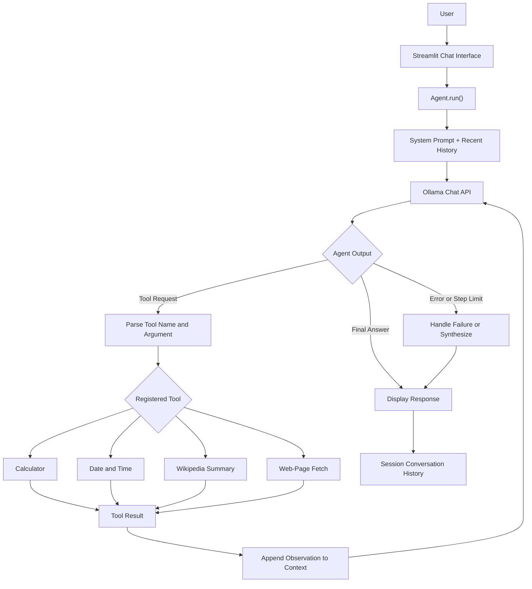

# ✦ Nova AI — Modern Ollama Chatbot

### A Local-First AI Assistant Powered by Ollama, Python & Streamlit

Nova AI is a local-first conversational AI application built with **Python, Streamlit, and Ollama**. It combines a modern chat interface with locally hosted language models and a lightweight tool-using agent that can perform calculations, retrieve date and time information, fetch Wikipedia summaries, and extract readable text from web pages.

The project demonstrates how to integrate a language model with external tools through an agent loop, maintain conversation context during a session, and build an interactive AI application with a custom user interface.

<p align="center">
  <a href="https://www.python.org/" target="_blank">
    
  </a>
  <a href="https://streamlit.io/" target="_blank">
    
  </a>
  <a href="https://ollama.com/" target="_blank">
    
  </a>
  <a href="https://docs.python.org/3/library/ast.html" target="_blank">
    
  </a>
  <a href="https://github.com/manojBhorge07" target="_blank">
    
  </a>
</p>

---

## 📌 Table of Contents

- [Overview](#-overview)
- [Project Objectives](#-project-objectives)
- [Key Features](#-key-features)
- [Technology Stack](#-technology-stack)
- [System Architecture](#-system-architecture)
- [How It Works](#-how-it-works)
- [Built-in Tools](#-built-in-tools)
- [Project Structure](#-project-structure)
- [Installation and Setup](#-installation-and-setup)
- [Usage Guide](#-usage-guide)
- [Configuration](#-configuration)
- [How the AI Agent Works](#-how-the-ai-agent-works)
- [Security Considerations](#-security-considerations)
- [Current Limitations](#-current-limitations)
- [Future Improvements](#-future-improvements)
- [Troubleshooting](#-troubleshooting)
- [Author](#-author)
- [Disclaimer](#-disclaimer)

---

## 🚀 Overview

Traditional chatbot applications often focus on sending a prompt to a language model and displaying the generated response. Nova AI extends this approach by introducing a tool-using agent architecture.

The application allows users to interact with an Ollama-hosted model through a Streamlit interface. When a question requires an external operation, the model can request one of the registered tools. The Python agent executes that tool, supplies the result back to the model, and continues until a final answer is produced or the configured step limit is reached.

The application is designed to run on a local machine, reducing dependence on hosted LLM APIs for text generation. However, its Wikipedia and web-fetching tools require an internet connection, and the selected local model must be installed and supported by Ollama.

### Why Nova AI?

- **Local inference:** Use compatible language models through Ollama.
- **Tool integration:** Combine language generation with practical Python functions.
- **Conversation context:** Preserve recent messages during the active Streamlit session.
- **Interactive configuration:** Adjust the selected model, temperature, and maximum agent steps.
- **Custom interface:** Use a responsive dark-themed chat UI with tool-activity indicators.
- **Extensible architecture:** Add more tools or experiment with RAG and specialized AI agents.

---

## 🎯 Project Objectives

1. Build a functional conversational AI assistant using locally hosted language models.
2. Integrate a language model with Python functions through a tool-execution loop.
3. Maintain conversational context across messages within a session.
4. Provide useful utilities such as mathematical calculations, date/time retrieval, Wikipedia summaries, and web-page text extraction.
5. Create a modern, responsive interface using Streamlit and custom CSS.
6. Demonstrate error handling, configurable inference settings, and a modular application structure.
7. Establish a foundation for future experiments with retrieval-augmented generation (RAG), APIs, and multi-agent workflows.

---

## ✨ Key Features

| Feature | Description |
|---|---|
| Local LLM integration | Communicates with compatible models through the Ollama API. |
| Interactive chat UI | Provides a custom dark-themed interface built with Streamlit. |
| Tool-using agent | Allows the model to request registered Python tools. |
| Conversation history | Keeps recent messages in session state and passes recent context to the agent. |
| Model selection | Provides a model selector with fallback model names. |
| Creativity control | Exposes a temperature slider from 0.0 to 1.0. |
| Agent-step control | Lets users configure the maximum number of tool/model-loop steps. |
| Calculator | Evaluates supported mathematical expressions using a restricted AST-based evaluator. |
| Date and time | Retrieves the current system date and time. |
| Wikipedia summaries | Retrieves article summaries through the Wikipedia REST API. |
| Web-page extraction | Fetches a web page and attempts to extract readable text. |
| Tool activity indicators | Shows which tool the agent is attempting to use. |
| Error handling | Reports several model connection and execution errors. |
| New chat | Clears the current session's conversation and usage counters. |
| Extensible tools | Supports adding additional Python functions to the tool registry. |

---

## 🛠 Technology Stack

| Technology | Purpose |
|---|---|
| [Python](https://www.python.org/) | Core application and agent logic |
| [Streamlit](https://streamlit.io/) | Interactive web interface |
| [Ollama](https://ollama.com/) | Local model serving and inference |
| [Requests](https://requests.readthedocs.io/) | HTTP communication with Ollama, Wikipedia, and web pages |
| [HTML & CSS](https://developer.mozilla.org/en-US/docs/Web/HTML) | Custom interface styling and chat layout |
| [Wikipedia REST API](https://en.wikipedia.org/api/rest_v1/) | Article-summary retrieval |
| Python AST | Restricted mathematical expression evaluation |
| JSON | Parsing Ollama's streamed API responses |
| Python `dataclasses` and `Enum` | Structured agent events and event types |

**Architecture:** The application uses a custom text-based tool-calling protocol rather than native structured function calling from the model API.

---

## 🏗 System Architecture



### Main Components

**1. Streamlit Interface — `app.py`**

Handles the user interface, sidebar configuration, session state, chat rendering, and communication with the agent.

**2. Agent Engine — `agent.py`**

Builds the system prompt, communicates with Ollama, interprets the tool protocol, executes registered functions, and manages the tool-use loop.

**3. Ollama Runtime**

Runs the selected language model locally and exposes its chat API at `http://localhost:11434/api/chat`.

**4. Tool Registry**

Stores the available Python functions and their descriptions so the agent can identify and execute supported operations.

---

## 🔄 How It Works

1. **User input:** The user enters a message in the Streamlit chat interface.
2. **Context preparation:** The agent combines the system instructions, recent conversation history, and current user message.
3. **Model inference:** The application sends the messages to the selected Ollama model.
4. **Output interpretation:** The agent interprets the model's output as a tool request, final answer, or ordinary text.
5. **Tool execution:** If a recognized tool is requested, the corresponding Python function runs.
6. **Observation:** The tool result is appended to the conversation as an observation for the model.
7. **Continuation:** The agent may request another tool, subject to the configured step limit.
8. **Final response:** The model generates an answer, which is displayed in the chat interface.
9. **Session update:** The application stores the user message and final assistant response in Streamlit session state.

The agent uses a custom protocol with tags such as `<tool>`, `<observation>`, and `<final>`. This makes the implementation relatively simple, but it also means malformed model output and prompt injection require careful handling.

---

## 🔧 Built-in Tools

### 1. Calculator

**Function:** `tool_calculator`

- Evaluates supported arithmetic expressions.
- Uses Python's Abstract Syntax Tree (AST) to restrict the operations that can be executed.
- Supports addition, subtraction, multiplication, division, exponentiation, modulo, floor division, and unary positive/negative operations.
- Avoids unrestricted use of Python's `eval()`.

Example prompts:

- `Calculate 245 * 18`
- `What is 15% of 8,500?`
- `Calculate (25 + 75) / 4`

The evaluator still needs stronger expression-length, nesting-depth, and computational-resource limits before being exposed to untrusted users.

### 2. Date and Time

**Function:** `tool_datetime`

Returns the current date and time using Python's system clock.

Example prompts:

- `What is the current date and time?`
- `What day of the week is it?`

The function uses the machine's configured local time and does not provide an explicit timezone-selection mechanism.

### 3. Wikipedia Summary

**Function:** `tool_search_wikipedia`

Uses the Wikipedia REST API to retrieve an article summary.

Example prompts:

- `Give me a summary of artificial intelligence from Wikipedia.`
- `Explain the history of Python using Wikipedia.`

The implementation retrieves a summary rather than performing a comprehensive search across all Wikipedia pages. Results depend on API availability and the query.

### 4. Web-Page Text Extraction

**Function:** `tool_web_fetch`

Attempts to retrieve text from a supplied HTTP or HTTPS URL.

The implementation:

- Sends an HTTP request with a timeout.
- Removes common script and style blocks.
- Strips HTML tags using regular expressions.
- Normalizes whitespace.
- Returns a limited portion of the extracted text.

Example prompt:

`Fetch and summarize the content of https://example.com`

**Important:** URL fetching must be hardened before public deployment. The current implementation does not adequately restrict private or internal network destinations, redirects, response sizes, or content types. Use only with trusted URLs until these issues are addressed.

---

## 📂 Project Structure

```text
nova-ai/
│
├── app.py              # Streamlit interface and session management
├── agent.py            # Agent loop, Ollama communication, and tools
├── requirements.txt    # Python dependencies
└── README.md           # Project documentation
```

### File Responsibilities

| File | Responsibility |
|---|---|
| `app.py` | UI layout, custom CSS, model selector, chat input, and event rendering |
| `agent.py` | System prompt, model requests, tool registry, calculator, Wikipedia, web fetch, and agent events |
| `requirements.txt` | Python package requirements |
| `README.md` | Installation, architecture, usage, and project documentation |

---

## 💻 Installation and Setup

### Prerequisites

Before running Nova AI, install:

- Python 3.10 or later
- Ollama
- A compatible Ollama model
- Git (optional, for cloning the repository)

### Step 1: Clone the Repository

Replace the placeholder below with your actual GitHub repository URL.

```bash
git clone https://github.com/manojBhorge07/nova-ai.git
cd nova-ai
```

If your repository has a different name, replace `nova-ai` with that repository name.

### Step 2: Create a Virtual Environment

**Windows — PowerShell**

```powershell
python -m venv .venv
.venv\Scripts\Activate.ps1
```

**Windows — Command Prompt**

```cmd
python -m venv .venv
.venv\Scripts\activate.bat
```

**macOS / Linux**

```bash
python3 -m venv .venv
source .venv/bin/activate
```

### Step 3: Install Dependencies

```bash
python -m pip install --upgrade pip
pip install -r requirements.txt
```

### Step 4: Install and Start Ollama

Install Ollama from the official website:

https://ollama.com/download

Start the Ollama service if it is not already running:

```bash
ollama serve
```

If Ollama is already running as a background service, you generally do not need to start it a second time.

### Step 5: Download a Model

For example, download Llama 3.2:

```bash
ollama pull llama3.2
```

You can also download other models supported by your installation, subject to your computer's RAM, available storage, and hardware capabilities.

To check which models are installed:

```bash
ollama list
```

### Step 6: Run Nova AI

```bash
streamlit run app.py
```

Open the local address printed in the terminal, usually:

`http://localhost:8501`

Keep Ollama running while using the application.

---

## 🧭 Usage Guide

1. Start Ollama and confirm that your selected model is installed.
2. Launch Nova AI with Streamlit.
3. Select a model from the sidebar.
4. Adjust the creativity slider if needed.
5. Set the maximum number of agent steps.
6. Enter a question in the chat input.
7. Watch for tool-activity indicators when the agent requests a tool.
8. Review the generated answer.
9. Select **New chat** to clear the active conversation and reset the displayed usage counters.

### Example Prompts

| Category | Example |
|---|---|
| General assistance | `Explain how large language models work.` |
| Mathematics | `Calculate 1250 * 48 / 6.` |
| Date and time | `What is the current date and time?` |
| Wikipedia | `Summarize the history of machine learning using Wikipedia.` |
| Web extraction | `Fetch the text from https://example.com and summarize it.` |
| Multi-step reasoning | `Find a Wikipedia summary of neural networks and explain it simply.` |

Tool selection is model-dependent. A model may not always recognize when a tool is required or may produce an incorrectly formatted tool request.

---

## ⚙️ Configuration

Nova AI exposes several settings in the Streamlit sidebar.

| Setting | Default / Behavior | Purpose |
|---|---|---|
| Model | First model in the available selector | Chooses the model passed to the Ollama API |
| Creativity | `0.4` | Controls the model's sampling temperature |
| Maximum tool steps | `8` | Limits iterations in the agent loop |
| Context window | `8192` | Configured through Ollama's `num_ctx` option |
| Request timeout | 180 seconds for model requests | Limits waiting for Ollama responses |

The current model selector includes fallback names such as `llama3.2`, `mistral`, `gemma3`, and `qwen2.5`. The model-discovery function should be corrected to query Ollama's model-tags endpoint so that it can reliably display installed models.

The current application uses session state for conversation context. Conversations are not saved to a persistent database.

---

## 🧠 How the AI Agent Works

The agent is implemented in `agent.py` and follows a repeated model–tool interaction pattern.

### Agent Event Types

| Event | Purpose |
|---|---|
| `TOOL_CALL` | Reports a tool the model wants to execute |
| `TOOL_RESULT` | Contains the result returned by the selected tool |
| `FINAL` | Carries the assistant's final response |
| `ERROR` | Reports an error during execution |
| `DONE` | Signals completion of the agent loop |

### Tool Registry

The `TOOLS` dictionary defines the functions that the model can request. Each entry contains tool metadata, including its name, description, argument information, icon, and callable function.

This registry provides an extension point for new capabilities such as:

- Retrieval-augmented generation (RAG)
- Database queries
- Custom REST APIs
- Local document retrieval
- Specialized AI workflows

Any additional tool should validate its arguments, limit its permissions, handle errors, and avoid exposing secrets or unrestricted system access.

### Model Communication

The application sends messages to Ollama's chat endpoint using HTTP requests and processes its streamed JSON response. The agent buffers generated text while looking for the expected protocol markers, then executes a tool or emits a final answer.

Although Ollama responses are consumed as a stream internally, the UI does not consistently display each generated token as it arrives. The visible final response is generally emitted after the agent identifies a completed answer.

---

## 🔐 Security Considerations

Nova AI is a local development and portfolio project. Review these points before using it with untrusted input or exposing it to a network.

- **Web-fetch SSRF risk:** Restrict URL destinations and redirects; block loopback, private, link-local, and other internal addresses. Validate resolved IP addresses and each redirect destination.
- **HTML injection risk:** Model-generated final text is inserted into HTML without consistently escaping or sanitizing it. Render untrusted output as Markdown or plain text using safe rendering mechanisms.
- **Tool argument validation:** Add explicit schemas and validation for tool names, arguments, URL inputs, and expression size.
- **Calculator resource limits:** Bound expression length, AST depth, numeric magnitude, and computational complexity.
- **Prompt injection:** Web pages and retrieved text may contain instructions designed to manipulate the model. Treat tool output as untrusted data.
- **Network exposure:** The current Ollama endpoint is configured for localhost. Review network binding, access control, and deployment settings before allowing remote access.
- **Sensitive information:** Do not enter passwords, API keys, private documents, or confidential business data unless the application's privacy and security controls have been reviewed.

The application does not implement authentication, authorization, persistent audit logging, or a comprehensive security policy for tool execution.

---

## ⚠️ Current Limitations

The following are known limitations based on the current implementation:

1. **Model discovery:** The model-discovery function uses an invalid URL. The Ollama tags endpoint should be used instead.
2. **Fallback model names:** The fallback list may include models that are not installed on the user's machine.
3. **Untrusted HTML rendering:** Assistant output is inserted into HTML without adequate sanitization.
4. **Unrestricted web destinations:** The web-fetch tool can request destinations that should be blocked in a secure deployment.
5. **Basic tool protocol:** Tool calls use a custom text format rather than schema-validated native function calling.
6. **Session-only memory:** Conversation history is not persisted after the active session is cleared or lost.
7. **Limited observability:** Tool results are stored as events but are not fully presented in the conversation interface.
8. **No formal evaluation suite:** The project does not include automated agent tests, tool accuracy benchmarks, or a systematic response-quality evaluation.
9. **Model-dependent behavior:** Tool selection, formatting, reasoning quality, and response speed vary by model and hardware.
10. **External service dependency:** Wikipedia and web fetching require internet access, even though text generation runs locally.

These limitations should be addressed before treating the application as a production-ready assistant.

---

## 🚀 Future Improvements

### Agent and Model Improvements
- Replace the text-based protocol with structured tool calls and JSON-schema validation.
- Improve model discovery using Ollama's `/api/tags` endpoint.
- Add tool-specific retries, timeouts, and structured error responses.
- Improve cancellation and user-visible streaming.
- Add model capability checks and clearer handling of missing models.

### Security and Reliability
- Add URL allowlists and SSRF protections.
- Sanitize model output and render it through a safe Markdown pipeline.
- Add strict calculator resource limits.
- Validate every tool argument before execution.
- Add automated unit and integration tests.

### Advanced AI Capabilities
- Add RAG for local PDFs, DOCX files, and other documents.
- Implement vector search and source citations.
- Add conversation export and persistent chat storage.
- Add configurable system prompts and per-tool permissions.
- Explore LangChain, LangGraph, or a custom multi-agent workflow.

### Product and UI Improvements
- Display tool results and sources in the chat interface.
- Add a model-management and health-check screen.
- Add chat history, search, rename, and delete controls.
- Provide usage analytics and request-duration metrics.
- Add Docker-based deployment and environment-specific configuration.

---

## 🛠 Troubleshooting

### Ollama is not detected

Start the Ollama service:

```bash
ollama serve
```

Check the local API:

```bash
curl http://localhost:11434/api/tags
```

On Windows, you can also open that URL in a browser.

### The selected model is unavailable

Check installed models:

```bash
ollama list
```

Download the model you want to use:

```bash
ollama pull llama3.2
```

Make sure the model name selected in the interface matches an installed model.

### Python dependency errors

Activate your virtual environment and reinstall dependencies:

```bash
python -m pip install -r requirements.txt
```

### The assistant does not use a tool

Tool use depends on the model following the custom protocol. Try a simpler, explicit prompt, reduce ambiguity, or use a compatible model. The current implementation does not guarantee that every suitable request will trigger the correct tool.

### The application is slow

Local inference speed depends on model size, available RAM, GPU acceleration, context length, and the complexity of the prompt. Try a smaller compatible model and close other resource-intensive applications.

---

## 👨‍💻 Author

**GitHub:** [manojBhorge07](https://github.com/manojBhorge07)

**LinkedIn:** [Connect on LinkedIn](https://in.linkedin.com/in/manoj-bhorge-630a81287)

This project is part of my hands-on exploration of Python development, local language models, conversational AI, and tool-using AI agents.

---

## 📚 References

- [Python Documentation](https://docs.python.org/3/)
- [Streamlit Documentation](https://docs.streamlit.io/)
- [Ollama Documentation](https://docs.ollama.com/)
- [Requests Documentation](https://requests.readthedocs.io/)
- [Wikipedia REST API](https://en.wikipedia.org/api/rest_v1/)

---

## ⚖️ Disclaimer

## ⚖️ Disclaimer

Nova AI is provided “as is,” without guarantees of accuracy, reliability, or availability. AI-generated responses may be incorrect, so verify important information independently. Use the application at your own risk. The developer is not responsible for any loss or damage arising from its use, to the extent permitted by applicable law.

**Built with Python, Streamlit, and Ollama.**
